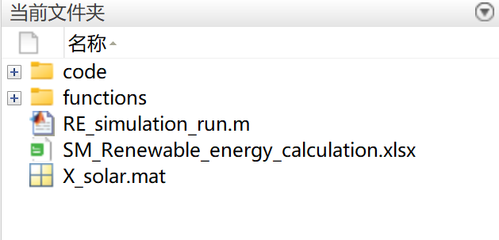
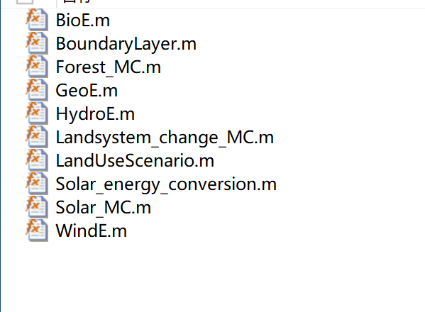

# Reliability and Economics of Microgrid Dispatch Based on Incentive-Type Demand Response (Matlab Code Implementation)

A flexible random scheduling framework to evaluate the short-term reliability and economics of islanded microgrids (MG) under different incentive-based DR (IBDR) plans.

## Images

<!-- PAYMENT_BLOCK -->

## Get this dataset

- Payment link (Stripe): [Buy now](https://buy.stripe.com/3cs8yP7sY87d0vu9AB)
- Payment QR code: 

<!-- /PAYMENT_BLOCK -->
